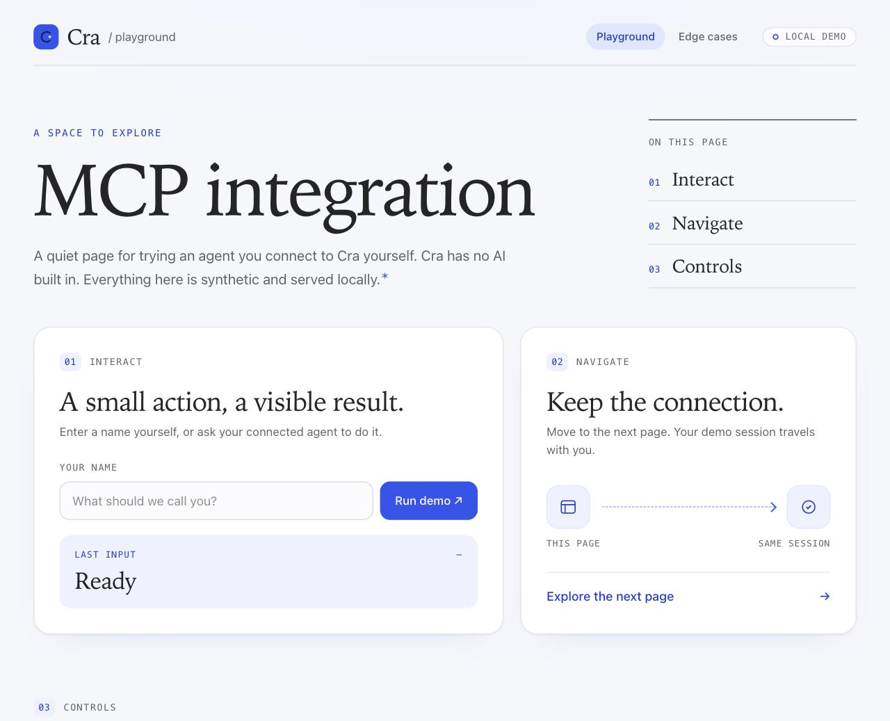
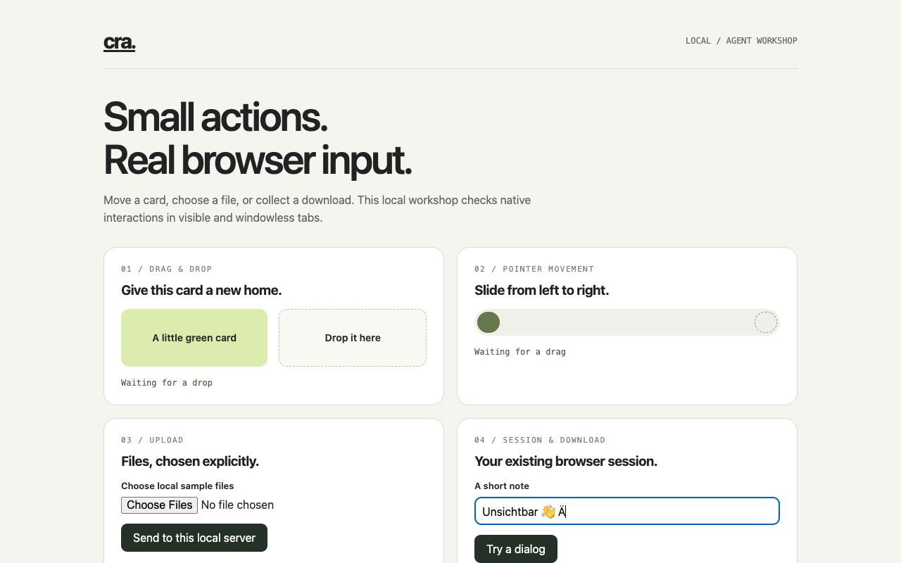

# Local MCP access

Cra's optional MCP server lets an external agent work in the browser's existing
signed-in sessions. This integration does not run a model or contact an AI provider itself.
The server is off by default.

In **Settings → Advanced**, enable **Allow local agents to control Cra**, then
choose **Copy MCP Configuration**. Add that entry to your client's MCP settings.
Keep Cra running. Copy the configuration again after moving the app or changing
profiles. CraDev uses a separate profile and socket from the installed Cra.

## Tools

| Tool | Purpose |
| --- | --- |
| `tabs_list` | Normal tabs and this connection’s background tabs, IDs, loaded state and ownership |
| `tab_open` | Open an HTTP(S) page in the current profile; optional `background: true` for a windowless agent tab |
| `tab_show` | Show a tab and wake it if needed; brings the browser forward |
| `tab_close` | Close an unpinned, unsplit tab opened by this connection |
| `page_read` | Visible text in pages of up to 20,000 UTF-16 units, plus 50 bounded links |
| `page_snapshot` | Compact main-frame accessibility snapshot with stable element refs |
| `page_navigate` | Request an HTTP(S) navigation through Chromium |
| `page_history` | Back, forward or reload |
| `page_wait` | Wait for loading and optional exact URL, text or CSS target state |
| `page_click` | Humanized Chromium mouse click |
| `page_hover` | Curved pointer movement without a click |
| `page_scroll` | Paced wheel events at a target, including nested scroll regions |
| `page_fill` | Replace editable text using native selection, Backspace and key events |
| `page_type` | Type at the current caret; append when first focusing another field |
| `page_press` | A key with optional Shift, Control, Alt or Meta modifiers |
| `page_select` | Select one HTML option using native focus and keyboard type-ahead |
| `page_drag` | Native HTML drag/drop or pointer drag from a ref/selector to `targetSelector` |
| `page_upload` | Select absolute local files in a file input, including a hidden input |
| `page_download` | Start a signed-in download in an owned background tab |
| `download_status` | Download progress, terminal status and completed local path |
| `download_cancel` | Cancel an unfinished download and remove its partial file |
| `page_screenshot` | Viewport JPEG as MCP image content, limited to 1280 pixels |
| `page_pdf` | PDF in the profile's private `mcp-exports` folder; returns path and size |
| `page_evaluate` | Advanced JavaScript; use the native tools for interaction |

Use `page_snapshot` first, then supply the returned `ref` to an input tool. A
main-frame CSS `selector` is also accepted. Supply exactly one of them; omit both
for `page_press` to act on current focus. A reference never moves to a replacement
node. Detached nodes, old documents and replaced browser runtimes invalidate it.
Take another snapshot after such an error. Repeated snapshots preserve IDs for
surviving nodes. Editable values and their accessibility descendants are omitted;
labels and other page content remain untrusted website text and can contain user data. This is not a general redaction guarantee.

`page_read` returns a JSON object directly. Continue with its `nextOffset` until
that is null. Offsets are UTF-16 positions in the current visible text; restart
from zero if the page changes. Link text and URLs are capped. For a particular
link or a larger selection, use a targeted read with `page_evaluate`.

Navigation acknowledges the request. Follow it with `page_wait`, preferably with
an exact `url` or expected `text`, before acting on the new page. A pending
navigation cannot satisfy a wait using the previous document. Waits accept
`selector` and `state` (`visible`, `hidden`, `attached`, `detached`), with
`timeoutMs` from 0 to 10,000. All supplied conditions must hold.

## Native input and its limits

The input tools use CDP `Input.dispatchMouseEvent` and `Input.dispatchKeyEvent`
on the existing Chromium page. They never call DOM `click()`, assign a field's
`value`, dispatch synthetic DOM input events, or script focus/selection. An
isolated world locates retained targets and observes trusted browser events.
Scrolling a target into view uses a Chromium DOM command. A select uses `DOM.focus`
and its built-in keyboard type-ahead, avoiding macOS popup-menu differences.
These are Chromium events, not movement of the Mac's physical mouse pointer.

Pointer paths are curved and eased (160–650 ms). Clicks hold for 55–110 ms;
key holds vary from 25–60 ms, with 35–95 ms gaps. There are no deliberate typos,
fingerprint changes or claims about evading automation detection. ASCII carries
key codes/modifiers. Unicode is split between scalars into at most three UTF-16
units per event, leaving room for Chromium's terminator. Complex emoji may produce
multiple intermediate input events; a page can transform or reject them.

For ordinary tabs, keep the tab visible and the window uncovered. macOS can report an occluded page
as hidden even when its DOM retains focus. Tools stop in that state. They also
refuse ambiguous, covered, detached, disabled, inert and read-only targets.

Text input supports text/search/email/url/tel/password inputs, textareas, and
plain contenteditable areas. Rich editors with nested formatting are refused.
Repeated spaces in plain contenteditable are compared using their visible-space
representation. Newlines are supported in textareas only. Each text call accepts
at most 256 graphemes, 256 emitted pieces and 4096 UTF-8 bytes. Controls other than
newline are refused. `page_type` refuses a non-empty input that does not expose
its caret; use `page_fill` instead. `page_press` never clicks an unfocused button
or link merely to focus it. Use current focus or explicitly interact first.

`page_select` supports single HTML selects with at most 100 enabled options. The
requested value must match one enabled option, with a unique ASCII letter as the first character of its label. Ambiguous initials are refused before input, so typing cannot transiently choose another option and trigger its change handler. Each selection allows Chromium’s one-second type-ahead buffer to expire before sending the initial. Custom menus use `page_click` on their individual options.

Iframe/shadow-root targeting, complex rich text, right/double-click and
JavaScript-dialog management are not exposed.
Little Windows are outside this implementation's tab list. Private tabs are
excluded from discovery and every operation, including requests with known IDs.

## Background tabs and file transfers

`tab_open({url, background: true})` creates a windowless 1280×800 CEF page using
that normal space’s profile, including HttpOnly cookies. Native input does not
activate a window or require a foreground tab. Only its connection can list or
use it. At most eight background tabs exist at once. Closing the connection or
turning MCP off closes them and cancels their transfers. Screenshots work through
Chromium. `tab_show` refuses these tabs: there is no seamless foreground handoff.
Windowless CEF uses Alloy hosting, so Chrome extensions, native browser UI and
permission prompts are unavailable. New media/permission requests, external app
launches and popups are refused. Ignored agent prompts preserve existing permission
values and embargo counters; ordinary Chromium history and permission-action metadata
remain shared with the normal profile. JavaScript dialogs are suppressed and file
choosers are cancelled; use page_upload for file selection. Ordinary tabs retain Chrome hosting and their normal behavior.

`page_drag` uses native pointer events, or intercepts Chromium’s real HTML drag
payload and delivers it with `Input.dispatchDragEvent`. It does not construct DOM
DragEvents or DataTransfer objects. Source and destination must have distinct,
uncovered hit areas in the same main-frame viewport. It supports pointer capture;
file drag, cross-frame drag and autoscrolling during a drag are outside its scope.
Results confirm trusted drop/release events; the client should also inspect the
page’s intended outcome. Cancellation sends Escape, releases the button and cancels interception. Pointer
capture may still deliver a release/click to its owner; cancellation cannot undo
already delivered input.

`page_upload` accepts `paths`, one to eight absolute regular-file paths, and an
exact file-input ref or selector. A file itself cannot be a symlink. Files are
copied into private staging before Chromium’s `DOM.setFileInputFiles` selects them;
JavaScript never assigns `files` or creates File objects. Selection does not submit
the form. The limit is 16 MiB per file, 64 MiB staged and 16 staging batches per tab,
with at most 16 transfer tabs. Copies cancelled before the Chromium selection are discarded. Once selection has
been dispatched, an uncertain outcome conservatively retains them. Copies live until that tab closes, its runtime is
replaced and cleaned up, or MCP stops, so Chromium can still read its File objects.
Use a background tab for predictable connection-lifetime cleanup. After a crash,
abandoned upload copies are removed when MCP next starts under its exclusive
profile lock; completed downloads are retained.

Download tools require an owned background tab. `page_download` starts an HTTP(S)
request through CEF and returns a `downloadId`; poll `download_status` until
`completed`, `cancelled` or `failed`. Only completed files expose a path. CEF follows
redirects and sends the profile’s matching cookies. One download per tab runs at a
time; each is limited to 64 MiB and 60 seconds, with eight attempts per tab. Site-
initiated downloads without an explicit tool request are blocked in background
tabs. The site’s suggested filename is metadata only; it cannot choose a disk path.
New UUID directories under `mcp-transfers` use mode 0700; completed files use 0600.
Cancelling or disconnecting removes partial files. Completed downloads remain for
the client/user to consume and remove. `download_cancel` leaves completed files intact. After cancellation, poll until
`canStartNext` is true before starting another download in the same tab, or close it and open a new one.
If a request remains unfinished after 60 seconds (including missing response
headers), its owned agent tab is closed to abort it; download_status remains
available and returns `timed_out` with recovery instructions. The closed entry
remains visible in tabs_list (`closed: true`) and retains its slot/status until
tab_close or disconnect. Call tab_close before opening its replacement. The
60-second limit is total elapsed time, even if bytes are still arriving.

## Cancellation and results

A per-tab lease prevents interleaving page operations. Other tabs and `ping`
remain responsive. Send `notifications/cancelled` with the active request ID to
stop further native input while retaining the connection. Closing the connection,
disabling MCP or replacing/closing the target also stops input. Cleanup releases
held keys/buttons and observers. Already delivered actions cannot be undone;
arbitrary JavaScript already dispatched cannot be rolled back.

Input results include observed trusted event counts. Text editing verifies the
result without echoing the value. Navigation that destroys an input observer is
reported as `navigation_observed`; read the destination to verify it. An error
may mean a partial action. Never blindly replay it.

Input deadlines scale from 45 to 100 seconds, with a 120-second transport ceiling
and bounded cleanup. Most Chromium calls must acknowledge within two seconds;
capture, snapshot, printing and evaluation have explicit longer bounds. Other
requests retain a 20-second transport ceiling. A timeout is normally a tool error;
a stuck transport closes that connection. Reconnect after a browser restart.

## Access and storage

The stdio subprocess communicates over a profile-specific Unix socket, mode 0600.
Both peers verify the same macOS user. No TCP port is opened. An exclusive lock
prevents another instance from replacing a live socket; cleanup removes only the
socket that instance created. Eight clients and 32 in-flight messages per client
are admitted. Input stops at stdin EOF; accepted non-input replies drain.

Clients negotiate MCP versions 2024-11-05, 2025-03-26, 2025-06-18 or 2025-11-25.
Initialize and send `notifications/initialized` before tool calls. Frames are
limited to 1 MiB; text tool results to 200,000 UTF-8 bytes. Oversized results fail
explicitly. Screenshots have a separate image-size bound. PDFs are capped at
16 MiB and written to new mode-0600 files in a private directory, without a
caller-selected output path. Exported files remain until removed by the user.

Enabling access permits local agents running as your macOS user to read page
content and act as the signed-in user. Configure confirmations in the agent
client. This is not a per-site permission or a browser-enforced payment/send
approval system. Treat page content as untrusted. Advanced settings show the last
tool call. The connected client's own data handling applies to content it reads.
Visible agent-created tabs remain normal tabs if their client disconnects. Windowless
background tabs are owned by one connection and close when it disconnects or MCP
is disabled. Both use the selected normal profile; neither is an isolated login session.

## Development checks

Run `scripts/test.sh`, then build the app and run:

```sh
python3 Tests/mcp_extended.py --app build/CraDev.app
python3 Tests/mcp_integration.py --app build/CraDev.app --pause-before-input --hold
```

This uses disposable profiles and synthetic local HTTP content. Keep the test window uncovered. The suite activates its tab through `tab_show`
before input. With `--pause-before-input`, create the printed
`INPUT_READY` file to start the input phase. `--hold` retains a clean playground
and prints a temporary MCP configuration for independent clients. Ctrl-C cleans
up the held instance. Logs and test results remain in the printed `/tmp` folder.

With Python 3.11+ and the official MCP SDK (`mcp>=1.20,<2`):

```sh
python Tests/mcp_sdk_smoke.py /tmp/cra-mcp-integration-…/mcp.json
python3 Tests/mcp_claude_smoke.py /tmp/cra-mcp-integration-…/mcp.json
```

Run clients sequentially against the fixture. The SDK test needs no model.
The optional Claude test needs an authenticated Claude Code installation and
sends only synthetic fixture content to its configured model provider.

The playground at `/` is the demo; `/regression` additionally shows deliberately
unusable controls for negative tests. Its design follows crabrowser.app, with
system fonts and no remote assets.


## Validation of the local contribution (2026-11-05)

The contribution was rebased onto upstream `ca6877c` and rebuilt with its pinned
CEF bundle. Both normal and separate Dev debug builds pass signature verification.
Existing unrelated compiler/runtime warnings remain.

`scripts/test.sh` passed: 441 CraCore tests in 77 suites, the store/lifecycle and
other harnesses, 63 recorder checks, MCP transport/bridge and lint. The coverage
gate passed at 97.8% of measured changed executable lines (770/787) and 99.4% of
CraCore. CEF/AppKit glue is outside those percentages and is exercised by the
real-browser suites.

The final 100-check integration and 67-check extended native suite passed.
The official MCP Python SDK 1.30.0 and authenticated Claude Code each exercised
all 24 tools on the final build; Claude returned 37 successful responses and
independently verified native input, navigation and background file interactions.
Earlier full integration and independent client journeys also passed repeatedly.

The extended suite exercises windowless input and screenshots, trusted HTML drag
payloads, pointer capture, visible/hidden/multiple uploads and byte-for-byte HTTP
delivery, HttpOnly session sharing, redirects, canonical URLs, private file modes,
quota handling, early close/disconnect and native CEF browser counts. It waits for
the real 60-second download deadline and checks recovery. Permission regressions
cover six repeated prompts and six immediate navigations, preserve a seeded user
permission history, and compare the saved settings after a clean shutdown. The
original permission regression was confirmed to fail against the previous binary.

Claude reviewed the native implementation and re-reviewed concrete fixes for
callbacks, cancellation, file quotas, dialogs and shared permission settings.
These are source reviews and local fixture tests, not a guarantee of arbitrary-site
compatibility. GitHub Actions reports remote CI separately.

The unchanged recorder budget is 0.1% of one CPU core. On the final rebased build,
`sleep-tabs` and `dev-mode` both passed at 0.061%, together with their memory and
stall checks. Earlier repeated runs also passed. The optimization reduces callback
and process-sampling overhead; `freeDiskBytes` now excludes purgeable data (see
[performance.md](performance.md)).

The Settings toggle was also tested with an active client and agent tab: client
EOF, socket removal, new-client rejection, agent closure and staged-upload cleanup.
The integration tests use process-local command-line overrides; persistent MCP
settings remain off. Completed exports are deliberately retained.

The commands above reproduce the tests using synthetic local fixtures. Screenshots
below show the playground and windowless agent viewport.




